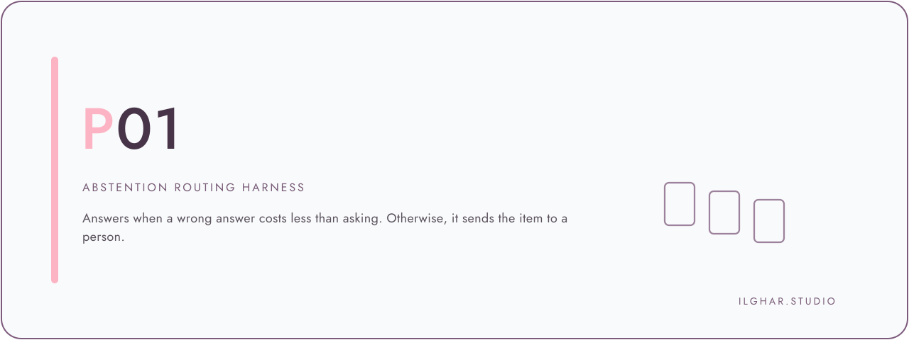
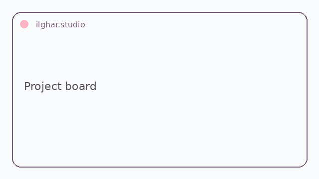
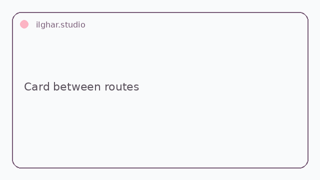

<!-- Copy to the top of every README. Replace REPO, files in docs/hero/. -->

  <a href="https://ilghar.github.io/abstention-routing-harness/">
    <picture>
      <source media="(prefers-color-scheme: dark)" srcset="docs/hero/hero-dark.svg">
      
    </picture>
  </a>

<b><a href="https://ilghar.github.io/abstention-routing-harness/">OPEN THE LIVE APP</a></b> | <a href="#how-it-works">HOW IT WORKS</a>

<!-- Function previews: one per app function, GIF/SVG, each linking into the live app -->
| <picture><source media="(prefers-color-scheme: dark)" srcset="docs/hero/f1-dark.webp"><source media="(prefers-color-scheme: light)" srcset="docs/hero/f1-light.webp"></picture> | <picture><source media="(prefers-color-scheme: dark)" srcset="docs/hero/f2-dark.webp"><source media="(prefers-color-scheme: light)" srcset="docs/hero/f2-light.webp"></picture> |
|---|---|

## How it works
- Give it a case record with an independent scope label and recorded proposals.
- Validation gates run, then the harness abstains on conflict or admits only clean agreement.
- It returns an advisory route or a human-review queue row with a plain-language reason.

ilghar.studio
