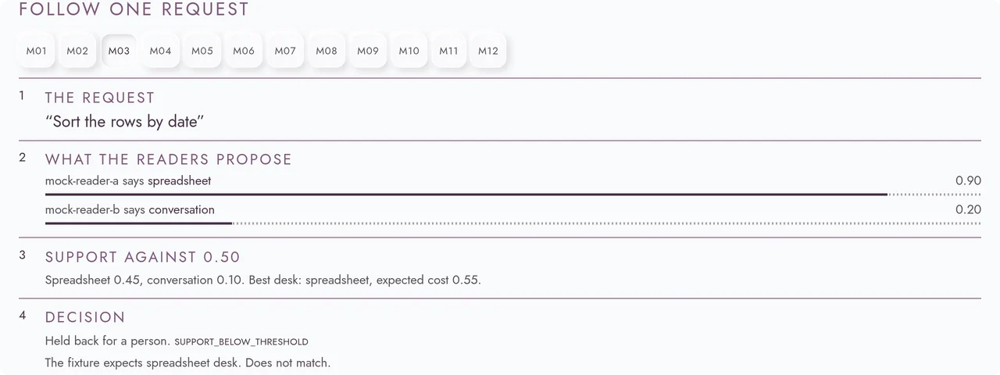

  <a href="https://ilghar.github.io/abstention-routing-harness/">
    <picture>
      <source media="(prefers-color-scheme: dark)" srcset="docs/hero/hero-dark.webp">
      
    </picture>
  </a>

# Abstention routing harness

A harness that admits an answer only when the case is clean, and otherwise sends the item to a person.

Open the live app: [ilghar.github.io/abstention-routing-harness](https://ilghar.github.io/abstention-routing-harness/) · Repository: [Ilghar/abstention-routing-harness](https://github.com/Ilghar/abstention-routing-harness)

## How it's used

Give it a case record with an independent scope label and recorded proposals. Validation gates run, then the harness abstains on conflict or admits only clean agreement. It returns an advisory route or a human-review queue row with a plain-language reason.

[ilghar.studio](https://ilghar.studio)
