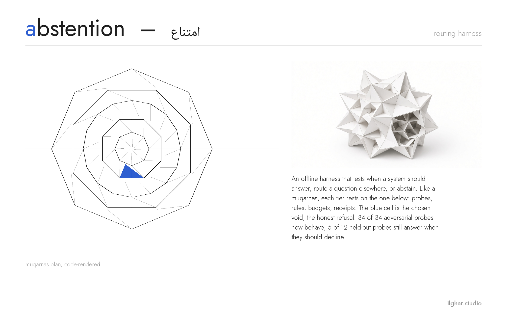
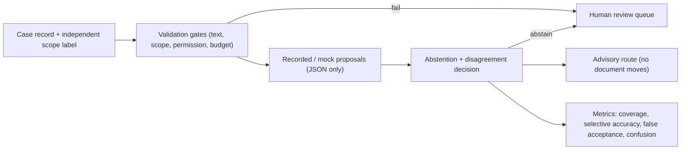

# Abstention & Routing Harness

**A small, strict referee that decides which review desk an incoming item belongs to, and knows when to say “I don’t know, a person should look at this.”**



*Project board, ilghar.studio. A dark version is in `assets/board-dark.svg`.*

## The question
> How can a routing system abstain reliably on mixed, malformed, conflicting or out-of-domain requests without mistaking model confidence for authority?

Picture an archive of mixed material: spreadsheets, chat threads, notes in English and German. Every item has to reach the right review desk. A language model can suggest a desk instantly, and it sounds just as sure when it is wrong.

The original study behind this project made that concrete. A local multilingual reader proposed queues on a twenty-item historical fixture and failed 12 of 20 (by my notes from that study, not re-run here), including one “false winner”: it confidently picked a desk for an item that belonged to neither. Confidence was being mistaken for authority.

This harness turns the lesson into rules you can test. A suggestion is only accepted when the item’s type was confirmed independently, the text is readable and harmless, the budget is valid, and every reader agrees. Everything else goes to a person, with a reason written in plain language. The harness never moves a document; it only advises.

## Who it is for
- **People building triage or routing on top of language models:** A ready-made set of gates, reason codes and metrics for measuring how often the system admits work it should have refused.
- **Evaluators and reviewers:** Every decision carries a reason code and a stable identity hash, so runs can be compared and audited line by line.
- **Archivists and operations teams:** A prioritised human review queue that explains why each item was held back, instead of a silent “unknown”.

## Install and run (offline, Python ≥ 3.11, no dependencies)
```sh
python3 -m venv .venv && . .venv/bin/activate   # isolated environment (Windows: .venv\Scripts\activate)
python3 -m pip install --no-index .          # console script: abstention-routing-harness
PYTHONPATH=src python3 -m unittest discover -s tests -v
sh examples/run.sh                           # reinstall in a temp venv and compare outputs with examples/expected.sha256
```
Receipts for every run live in `tests/receipts/`. Dependencies: `docs/DEPENDENCIES.md`.

## Architecture

Static fallback: `docs/architecture.svg`. Deeper notes: `docs/ARCHITECTURE.md`, `docs/FAILURE_ANALYSIS.md`, `docs/RESULTS.md`, `docs/ORIGINAL_VISION.md`.


## How it works
1. **Record + independent scope label.** Each case carries its text and a scope label confirmed by someone other than the model (for example, “this really is a spreadsheet”). Without it, nothing is admitted.
2. **Validation gates.** Invisible or empty text, requests to change permissions or take actions, and invalid or exhausted budgets are stopped before any proposal is read.
3. **Recorded proposals.** Proposals from one or more readers arrive as JSON (recorded, mocked or from the local keyword rule). No network call and no model loading happen inside the harness.
4. **Abstain or advise.** Malformed, missing, self-abstaining or conflicting proposals are held back. Only clean agreement becomes an advisory route; documents are never moved.
5. **Metrics with denominators.** Coverage, selective accuracy, false acceptance and per-class confusion, always as counts over a stated n with Wilson intervals, never a bare percentage.
6. **Human review queue.** Every held-back item becomes a row in a prioritised worklist with the reason in plain words.

Stages (see `docs/architecture.mmd`, authoritative, and `docs/architecture.svg`): Input record + independent scope label → Pure validation and advisory policy → Recorded or mocked model proposal adapter → Abstention + disagreement decision → Per-class confusion/coverage/error report → Human review queue


*When readers disagree, the item stays put. Disagreement is treated as evidence, not averaged away.*

## Commands, with real output
### `abstention-routing-harness run fixtures/synthetic_cases_m03.json --out out/`
Apply the policy to 16 hand-written cases with mock proposals. Writes decisions.json and report.json. Mock data, not a model result.

```
{"coverage": {"admitted": 6, "denominator": 16, "value": 0.375}, "false_acceptance": {"count": 1, "denominator": 4, "value": 0.25}, "selective_accuracy": {"correct": 4, "denominator": 6, "value": 0.666667}}
```

### `abstention-routing-harness slice inputs/synthetic_queue_fixture.json --probes fixtures/ood_probes_m04.json --out out/m04`
End-to-end slice: 20 cleared EN/DE queue items plus 7 out-of-domain and mixed probes, through the local keyword proposer and the policy. The rule was tuned on this same fixture, so this is not held-out.

```
{"coverage": {"admitted": 21, "denominator": 27, "value": 0.777778}, "false_acceptance": {"count": 1, "denominator": 7, "value": 0.142857}, "selective_accuracy": {"correct": 20, "denominator": 21, "value": 0.952381}}
```

### `abstention-routing-harness collection . --out out/c`
Validate the versioned case collection against schemas/case.schema.json and write a hashed manifest.

```
{"errors": 0, "files": {"dev_queue.json": 20, "dev_probes.json": 7, "heldout_probes.json": 24}}
```

### `abstention-routing-harness baselines . --out out/b`
Compare three baselines on dev and test: always abstain, always pick the majority desk, and the keyword rule. Values are [coverage, selective accuracy, false acceptance].

```
{"dev": {"always_abstain": [0.0, null, 0.0], "majority_spreadsheet": [1.0, 0.37037, 1.0], "keyword_rule": [0.777778, 0.952381, 0.142857]}, "test": {"always_abstain": [0.0, null, 0.0], "majority_spreadsheet": [1.0, 0.25, 1.0], "keyword_rule": [0.458333, 0.545455, 0.416667]}}
```

### `abstention-routing-harness failure . --out out/f`
Run the 34-case adversarial suite (invisible text, surrogates, NaN budgets, oversized proposals) and classify held-out errors.

```
{"adversarial_passed": "34/34", "test_errors": {"over_abstention": 6, "false_acceptance": 5}}
```

### `python3 -m abstention_routing_harness.review_queue out/decisions.json --cases fixtures/synthetic_cases_m03.json --out out/queue.md`
New. Turn decisions into a prioritised human worklist (Markdown + JSON) with a plain-language reason for every held-back item.

```
{"queued": 10, "of": 16, "by_reason": {"BUDGET_EXCEEDED": 1, "BUDGET_INVALID": 2, "INPUT_NOT_PERMITTED": 1, "NO_PROPOSAL": 1, "PROPOSALS_CONFLICT": 1, "PROPOSAL_ABSTAINED": 1, "PROPOSAL_MALFORMED": 1, "SCOPE_UNVERIFIED": 1, "TEXT_INVALID": 1}}

| Priority | Case | Reason | Why it was held back | Excerpt |
|---|---|---|---|---|
| 1 | B08 | `SCOPE_UNVERIFIED` | Nobody independently confirmed what kind of item this is, so no proposal may be trusted. | Format the header row |
| 1 | B09 | `INPUT_NOT_PERMITTED` | The text asks to change permissions, authority or actions; that is never routed automatically. | Archive this conversation |
```

## MOCK — hand-written confidences, not a result
```sh
PYTHONPATH=src python3 -m abstention_routing_harness.report --out reports/mock fixtures/mock_confidence_proposals_m08.json
```
```
{"base_accuracy": 0.5833, "cost_accuracy": 0.3333, "best_min_support": 1.0, "n": 12}
```
Writes `reports/mock/index.html`, `confusion.json` and `calibration.json`. The confidences in the fixture were written by hand to exercise the cost/risk policy; these numbers say nothing about any real model. On this mock fixture the cost policy routes 4 of 12 correctly against 7 of 12 for the existing policy.

## Measured results
| Metric | Value | Kind | Caveat |
|---|---|---|---|
| keyword rule false acceptance (test) | 5/12 = 0.417 (Wilson 95% 0.193–0.681) | measured, synthetic | test probes written by rule author; not blind |
| keyword rule selective accuracy (test) | 6/11 = 0.545 | measured, synthetic | small n |
| keyword rule coverage (test) | 11/24 = 0.458 | measured, synthetic |  |
| keyword rule false acceptance (dev) | 1/7 = 0.143 | measured, synthetic | rule developed on dev |
| majority-class false acceptance (test) | 12/12 = 1.0 | measured baseline |  |
| adversarial policy suite | 34/34 (24/34 before the hardening pass) | measured robustness | suite written by policy author |

**Status:** Measured rule baselines and adversarial robustness on synthetic cases; no model results. Private work in progress.

## Limitations
- All items are synthetic; no model was run. Mock results are labelled as mocks.
- Test probes were written by the same author after the rule existed, so they are not blind.
- Historical multilingual-reader fixtures are summaries, not re-runs, and measure a different task.
- Reviews so far are self-reviews; no independent reviewer yet.
- Illustrations are editorial images only; the native diagram is authoritative.

## Roadmap: the original ambition
| Next | Status | Where it comes from |
|---|---|---|
| Two-reader reconciliation with a real local reader plus a second, independent reader | planned; the policy already abstains on any conflict | original design paired a local multilingual reader with a second reader and only accepted agreement |
| Re-run the historical 20-item fixture with the local multilingual reader, offline | planned | the 12/20 failure (by my notes from that study, not re-run here) and the false winner that motivated the project |
| Blind held-out probes written by someone other than the rule author | open | current test probes are not blind |
| Calibration study before any confidence threshold is used | mechanism implemented, in-sample, mock data only; validated study still open | original metric list: calibration only after a separate validated study |
| Prioritised human review queue | implemented (review_queue) | original architecture ended in a human review queue |

## Credit
Concept, research direction, evaluation design and editorial: ilghar.studio.


## Embedding in ilghar.studio
`site/index.html` is a static page with no dependencies; its only script is the light/dark toggle. Its styles are scoped under `.ilg-case` and use the studio tokens in `site/DESIGN_TOKENS.json`. Content lives in `site/project.json` (schema `site/schema.json`); regenerate with `python3 tools/export_site.py`.

Private work in progress. License: not yet chosen.

<!-- commands:start (generated by tools/export_site.py) -->
## Feature index
- **Record + independent scope label.** Each case carries its text and a scope label confirmed by someone other than the model (for example, “this really is a spreadsheet”). Without it, nothing is admitted.
- **Validation gates.** Invisible or empty text, requests to change permissions or take actions, and invalid or exhausted budgets are stopped before any proposal is read.
- **Recorded proposals.** Proposals from one or more readers arrive as JSON (recorded, mocked or from the local keyword rule). No network call and no model loading happen inside the harness.
- **Abstain or advise.** Malformed, missing, self-abstaining or conflicting proposals are held back. Only clean agreement becomes an advisory route; documents are never moved.
- **Metrics with denominators.** Coverage, selective accuracy, false acceptance and per-class confusion, always as counts over a stated n with Wilson intervals, never a bare percentage.
- **Human review queue.** Every held-back item becomes a row in a prioritised worklist with the reason in plain words.

## Command index
- `abstention-routing-harness run fixtures/synthetic_cases_m03.json --out out/`: Apply the policy to 16 hand-written cases with mock proposals. Writes decisions.json and report.json. Mock data, not a model result.
- `abstention-routing-harness slice inputs/synthetic_queue_fixture.json --probes fixtures/ood_probes_m04.json --out out/m04`: End-to-end slice: 20 cleared EN/DE queue items plus 7 out-of-domain and mixed probes, through the local keyword proposer and the policy. The rule was tuned on this same fixture, so this is not held-out.
- `abstention-routing-harness collection . --out out/c`: Validate the versioned case collection against schemas/case.schema.json and write a hashed manifest.
- `abstention-routing-harness baselines . --out out/b`: Compare three baselines on dev and test: always abstain, always pick the majority desk, and the keyword rule. Values are [coverage, selective accuracy, false acceptance].
- `abstention-routing-harness failure . --out out/f`: Run the 34-case adversarial suite (invisible text, surrogates, NaN budgets, oversized proposals) and classify held-out errors.
- `python3 -m abstention_routing_harness.review_queue out/decisions.json --cases fixtures/synthetic_cases_m03.json --out out/queue.md`: Turn decisions into a prioritised human worklist (Markdown + JSON) with a plain-language reason for every held-back item.
- `python3 -m abstention_routing_harness.report --out reports/mock fixtures/mock_confidence_proposals_m08.json`: Score cases with the cost/risk policy (expected cost of each route vs the cost of handing to a person), sweep the support threshold, and write a confusion report (expected vs decided: spreadsheet / conversation / person) as JSON and reports/…/index.html. MOCK: the confidences in this fixture are hand-written to demonstrate the mechanism; the numbers are not a result, and the calibration is in-sample.

Full output for every command: `docs/CASE_PAGE.md`.
<!-- commands:end -->
